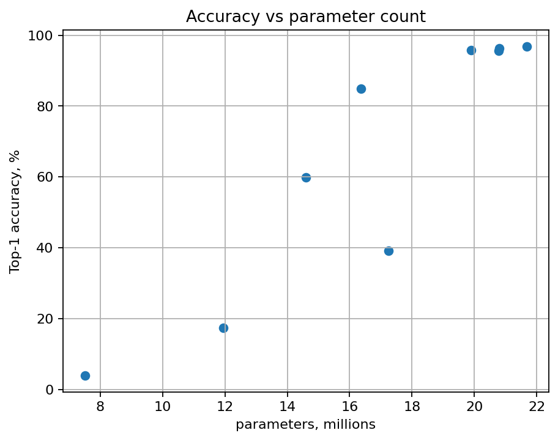
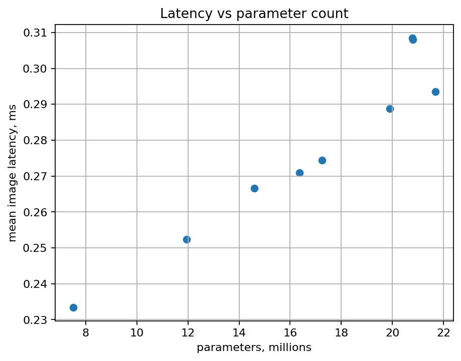

## Эксперименты со сжатием обучемых слоёв ИНС

Pipeline генерирует сводные таблицы и графики для сравнения baseline-моделей и моделей с SVD-сжатыми обучаемыми тензорами.

<p align="center">
  
  
</p>

Download dataset (AID):
kaggle CLI:

  ```bash
  #!/bin/bash
  kaggle datasets download jiayuanchengala/aid-scene-classification-datasets
  ```

cURL:

  ```bash
  #!/bin/bash
  curl -L -o ~/Downloads/aid-scene-classification-datasets.zip\
    https://www.kaggle.com/api/v1/datasets/download/jiayuanchengala/aid-scene-classification-datasets
  ```

## О репозитории

Рекомендуется выполнять программный код внутри docker контейнера. 
Наличие huggingface и kaggle токенов опционально. 

Внимание уделить парамтрам запуска контейнера, для "проброски" видеокарты.
```
	"runArgs": [
	  "--ipc=host",
	  "--gpus=all"
	],
```

Образ можно скачать командой:

```bash
  docker pull ghcr.io/bc-ru/pytorch-2.1.0-cuda11.8-cudnn8-runtime-timm-models:stable
```

В репозитории уже подготовлен файл конфигурации Dev Containers:

.devcontainer/devcontainer.json


Для запуска:

  1.  Откройте папку проекта в VS Code.
  2.  Нажмите Ctrl + Shift + P.
  3.  Выберите команду:

```
Dev Containers: Reopen in Container
```
После этого VS Code перезапустит проект внутри Docker-контейнера.

## Обучение на GPU

Для проверки доступности GPU в виртуальном окружении:

```bash
python - <<'EOF'
import torch
print("CUDA available:", torch.cuda.is_available())
print("Device count:", torch.cuda.device_count())
if torch.cuda.is_available():
    print(torch.cuda.get_device_name(0))
EOF
```