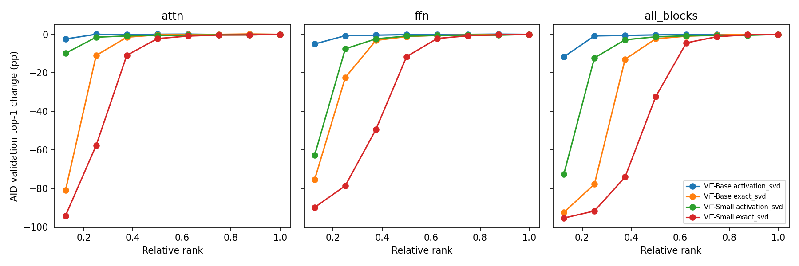

# ViT-Small и ViT-Base на AID

## Исходные модели

|architecture|total_params|validation_top1|test_top1|median_batch_ms_b1|median_batch_ms_b16|
|---|---|---|---|---|---|
|ViT-Small|21677214|0.973|0.968|1.790|13.329|
|ViT-Base|85821726|0.971|0.977|4.454|42.232|

Один checkpoint на архитектуру. Фиксированный seed-42 split: 7000 train, 1500 validation и 1500 test. До аппроксимации Base обучался 10 эпох с LR 1e-4 и batch 16×2; Small — 20 эпох с LR 3e-4 и batch 64×1. Различия включают влияние исходных весов и обучения.

ViT-Small, все блоки при ρ=0,5. Ordinary SVD даёт 65.000% на validation (-32.333 п.п. от dense), activation-SVD — 96.067% (-1.267 п.п.). Факторизованные модели сохраняют 67.35% параметров dense. В 6 из 6 бюджетных сравнений переход uniform → allocated одновременно снижает локальную MSE и validation top-1.

ViT-Base, все блоки при ρ=0,5. Ordinary SVD даёт 94.867% на validation (-2.267 п.п. от dense), activation-SVD — 96.867% (-0.267 п.п.). Факторизованные модели сохраняют 67.01% параметров dense. В 6 из 6 бюджетных сравнений переход uniform → allocated одновременно снижает локальную MSE и validation top-1.

## Глобальные замены при относительном ранге 0,5

|architecture|scope|method|relative_parameters|validation_delta_pp|latency_over_dense_b1|latency_over_dense_b16|
|---|---|---|---|---|---|---|
|ViT-Small|all_blocks|exact_svd|0.673|-32.333|1.016|0.872|
|ViT-Small|attn|exact_svd|0.918|-2.200|1.082|0.984|
|ViT-Small|ffn|exact_svd|0.755|-11.533|0.944|0.898|
|ViT-Small|all_blocks|activation_svd|0.673|-1.267|1.004|0.880|
|ViT-Small|attn|activation_svd|0.918|-0.467|1.079|0.997|
|ViT-Small|ffn|activation_svd|0.755|-0.867|0.954|0.893|
|ViT-Base|all_blocks|exact_svd|0.670|-2.267|0.860|0.785|
|ViT-Base|attn|exact_svd|0.918|-0.267|0.916|0.955|
|ViT-Base|ffn|exact_svd|0.753|-1.133|0.853|0.833|
|ViT-Base|all_blocks|activation_svd|0.670|-0.267|0.860|0.785|
|ViT-Base|attn|activation_svd|0.918|0.067|0.975|0.955|
|ViT-Base|ffn|activation_svd|0.753|-0.133|0.858|0.833|

При этом относительном ранге фактический ранг Small равен 192, Base — 384. В таблице доля параметров учитывает оба фактора и все сохранённые параметры модели. Отношение latency меньше единицы соответствует измеренному уменьшению медианного времени на том же batch.

## Области и одиночные замены

|architecture|configuration|method|validation_delta_pp|
|---|---|---|---|
|ViT-Small|early_ffn_r0500|exact_svd|-2.733|
|ViT-Small|late_ffn_r0500|exact_svd|-0.333|
|ViT-Small|middle_ffn_r0500|exact_svd|-0.800|
|ViT-Small|single_b0_mlp.fc1_r0125|exact_svd|-17.667|
|ViT-Small|single_b11_mlp.fc1_r0125|exact_svd|0.000|
|ViT-Small|single_b5_mlp.fc1_r0125|exact_svd|-0.333|
|ViT-Small|early_ffn_r0500|activation_svd|-0.400|
|ViT-Small|late_ffn_r0500|activation_svd|-0.133|
|ViT-Small|middle_ffn_r0500|activation_svd|-0.467|
|ViT-Small|single_b0_mlp.fc1_r0125|activation_svd|-5.000|
|ViT-Small|single_b11_mlp.fc1_r0125|activation_svd|-0.067|
|ViT-Small|single_b5_mlp.fc1_r0125|activation_svd|-0.467|
|ViT-Base|early_ffn_r0500|exact_svd|-0.200|
|ViT-Base|late_ffn_r0500|exact_svd|-0.267|
|ViT-Base|middle_ffn_r0500|exact_svd|-0.200|
|ViT-Base|single_b0_mlp.fc1_r0125|exact_svd|-2.133|
|ViT-Base|single_b11_mlp.fc1_r0125|exact_svd|0.067|
|ViT-Base|single_b5_mlp.fc1_r0125|exact_svd|-0.400|
|ViT-Base|early_ffn_r0500|activation_svd|0.000|
|ViT-Base|late_ffn_r0500|activation_svd|0.000|
|ViT-Base|middle_ffn_r0500|activation_svd|-0.067|
|ViT-Base|single_b0_mlp.fc1_r0125|activation_svd|-0.867|
|ViT-Base|single_b11_mlp.fc1_r0125|activation_svd|0.067|
|ViT-Base|single_b5_mlp.fc1_r0125|activation_svd|0.000|

## Распределение рангов при точном бюджете

|architecture|method|budget_ratio|parameters|local_MSE_delta|validation_delta_pp|
|---|---|---|---|---|---|
|ViT-Small|activation_svd|0.250|7521438|-24539.347|-34.800|
|ViT-Small|activation_svd|0.500|14599326|-10674.950|-6.267|
|ViT-Small|activation_svd|0.750|21677214|-3439.526|-0.067|
|ViT-Small|exact_svd|0.250|7521438|-87122.252|-1.867|
|ViT-Small|exact_svd|0.500|14599326|-46337.138|-52.400|
|ViT-Small|exact_svd|0.750|21677214|-17971.492|-9.000|
|ViT-Base|activation_svd|0.250|29198622|-29669.337|-2.133|
|ViT-Base|activation_svd|0.500|57510174|-11474.232|-1.133|
|ViT-Base|activation_svd|0.750|85821726|-3255.937|-0.133|
|ViT-Base|exact_svd|0.250|29198622|-113956.637|-12.467|
|ViT-Base|exact_svd|0.500|57510174|-55319.447|-60.800|
|ViT-Base|exact_svd|0.750|85821726|-19674.793|-2.533|

Здесь обе дельты вычислены как allocated минус uniform того же метода. Отрицательные значения в обоих столбцах показывают снижение локальной ошибки одновременно с потерей accuracy.

## Дообучение и dense-контроль

|architecture|configuration|method|accuracy_before|validation_top1|gain_pp|ce_before|validation_cross_entropy|test_top1|
|---|---|---|---|---|---|---|---|---|
|ViT-Small|dense_control|dense|0.973|0.972|-0.133|0.198|0.195|0.966|
|ViT-Small|global_all_blocks_r0500|exact_svd|0.650|0.958|30.800|1.356|0.233|0.956|
|ViT-Small|global_ffn_r0500|exact_svd|0.858|0.969|11.067|0.604|0.215|0.961|
|ViT-Small|global_all_blocks_r0500|activation_svd|0.961|0.967|0.600|0.243|0.217|0.961|
|ViT-Small|global_ffn_r0500|activation_svd|0.965|0.971|0.667|0.231|0.202|0.964|
|ViT-Base|dense_control|dense|0.971|0.973|0.133|0.198|0.204|0.968|
|ViT-Base|global_all_blocks_r0500|exact_svd|0.949|0.968|1.933|0.243|0.213|0.971|
|ViT-Base|global_ffn_r0500|exact_svd|0.960|0.969|0.933|0.184|0.202|0.971|
|ViT-Base|global_all_blocks_r0500|activation_svd|0.969|0.971|0.200|0.211|0.206|0.971|
|ViT-Base|global_ffn_r0500|activation_svd|0.970|0.969|-0.067|0.206|0.208|0.969|

## Интерпретация

Все дельты accuracy выражены в процентных пунктах относительно dense той же архитектуры на той же выборке. Compression ratio равен dense params / model params. Распределённые ранги оптимизированы отдельно на каждой архитектуре. Для allocated столбец rank_ratio обозначает uniform-бюджет, а реализованные ранги приведены по матрицам. Файл CSV содержит точные ранги и оба измеренных отношения latency для каждой пары. Пропущенное значение означает отсутствие соответствующего benchmark или final test.

Измерения получены на одной RTX 4070. P05/P95 описывают разброс синхронизированных повторов. Изолированный runtime-пик GPU не измерялся. Статистическая значимость различий по одному split не оценивалась.

[Все парные конфигурации](architectures.csv)
